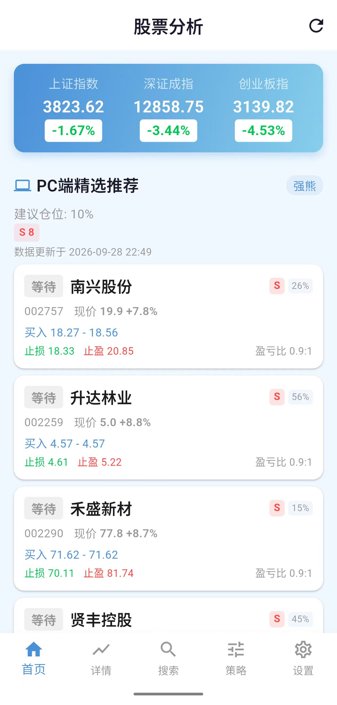
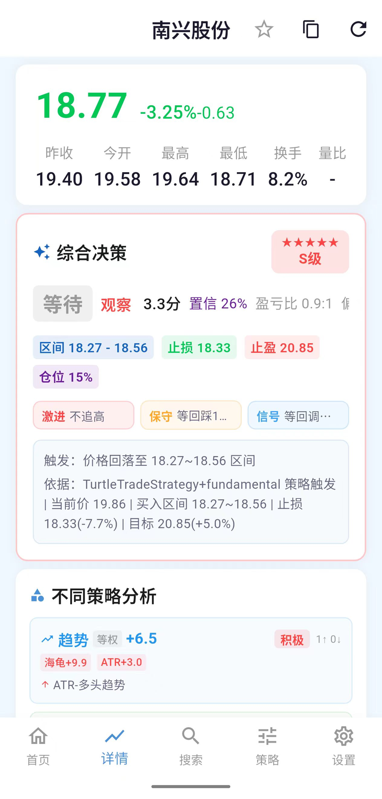
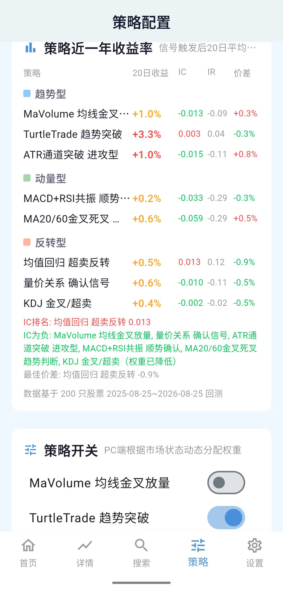
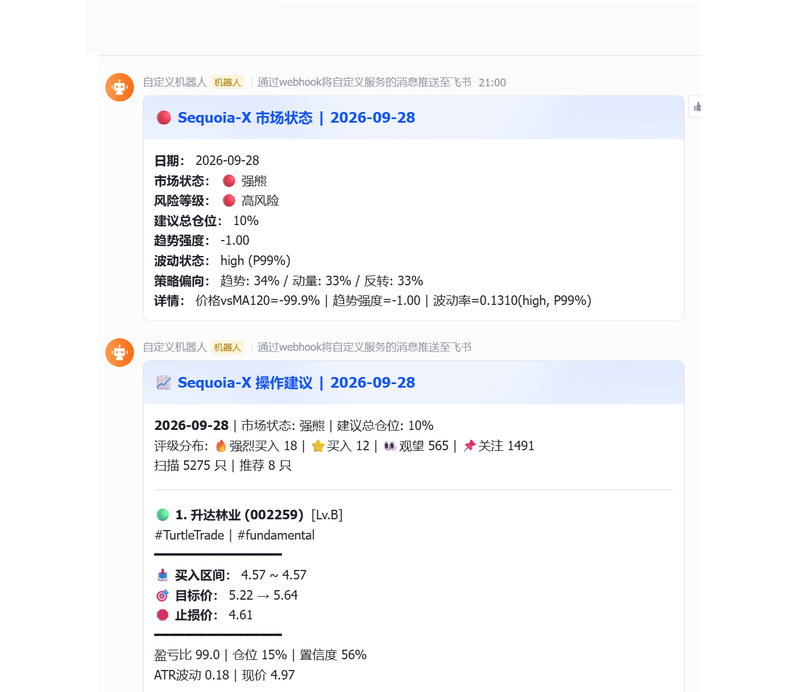

# Sequoia-X V3

> 主要面向在职人员在工作期间不方便使用PC端进行炒股的人。A 股量化选股系统（操作数据量大在PC端运行） + 手机端实时监控 | A-Share Quantitative Stock Selection & Mobile Monitoring System

基于 [sngyai/Sequoia-X](https://github.com/sngyai/Sequoia-X) 进行大幅改造和扩展，在此感谢原作者的贡献。

📌 原项目 MIT 协议，本衍生项目同样遵循 MIT 协议。

---

## 📸 项目预览

<p align="center">
  
  
  
</p>
<p align="center">
  
</p>

---

## 📱 项目简介

一个完整的 A 股量化交易辅助系统，由 **PC 端（选股引擎）**和 **手机端（实时监控）**两部分组成：

```
PC端 (每个交易日收盘后运行一次：手动跑 --rating，或装定时任务)
  ┌─ 全市场5000+只股票扫描
  ├─ 9大评级策略（体系A，rating/strategies.py）
  ├─ 按「评级类别 → 总分 → 置信度」排序取前15名生成操作建议
  ├─ 推送飞书 + 上传腾讯云COS
  └─ 手机端实时拉取数据

⚠️ 项目里有**两套互不相干的策略实现**，别把它们当成一套：
  · 体系A「评级策略」rating/strategies.py —— 9 个函数，驱动 --rating（生产）
  · 体系B「选股策略」sequoia_x/strategy/*.py —— 6 个类，驱动 --daily 与回测
  两者只有 maVolume / turtleTrade 两个名字重叠，而且是两份独立实现。

手机端 (盘中9:30-15:00)
  ┌─ 实时显示PC端推荐股票
  ├─ 实时行情监控 + 止损止盈价格告警
  ├─ 明确的操作建议（买入/持有/卖出）
  └─ 详情页15秒自动刷新
```

---

## ⚙️ PC端 — 量化选股系统

### 核心架构

```
新浪快照(日增量) ─→ SQLite ─→ 6策略选股 ─→ ConsensusEngine融合
                                   ↓
baostock(缺口/回填) ─→ 数据清洗 ←─── 9策略评级(市场状态加权)
                                   ↓
efinance(可选财务) ─┘       SignalGenerator信号生成
                                   ↓
                     ┌──── 飞书推送(操作建议) ────┐
                     │                            │
                     └── 腾讯云COS ─→ 手机端拉取 ──┘
```

数据源说明：
- **新浪财经批量快照** 日增量主数据源（`hq.sinajs.cn/list=`，一次 250 个代码，全市场约 20 个请求）
- **baostock** 缺口补齐与历史回填（前复权，含成交额；基准指数也走它，见下）
- **efinance** 可选，用于 fundamental 策略的全市场财务数据批量拉取（约 8s/5500只，含 ROE/营收增速/毛利率）；未安装或不可用时自动回退到 baostock 逐股查询
- **mootdx** 仅用于股票名称列表（TDX 服务端已拒绝 K 线请求，不再取行情）
- **基准指数**（中证500 = `sh.000905`、沪深300 = `sh.000300`）：与深市个股同号（000905 同时是厦门港务），因此单独用 baostock 的 `sh.` 代码更新，不走个股行情源

### 6 大选股策略

| 策略 | 类型 | 说明 |
|------|------|------|
| **MaVolume** | 趋势跟踪 | MA5金叉MA20 + 成交量放大1.5倍 |
| **TurtleTrade** | 趋势突破 | 20日新高 + 成交额过亿 + 阳线确认 |
| **HighTightFlag** | 动量 | 强动量后极度收敛缩量的旗形整理 |
| **LimitUpShakeout** | 反转 | 涨停次日放量收阴但不破昨收（洗盘） |
| **UptrendLimitDown** | 反转 | 上升趋势中放量跌停，捕捉错杀机会 |
| **RpsBreakout** | 动量 | RPS 极强动量突破（欧奈尔相对强度法，120日相对强度>90%） |

### 9 大评级策略

| 策略 | 类别 | 功能 |
|------|------|------|
| **MaVolume** | 趋势 | 均线金叉 + 放量确认 |
| **TurtleTrade** | 趋势 | 突破 + 趋势强度 |
| **MeanReversion** | 反转 | 超买超卖 + 布林带 + RSI 背离 |
| **VolumePrice** | 反转 | 量价配合验证 |
| **ATRChannel** | 趋势 | ATR 通道 + 趋势强度 |
| **MACD+RSI** | 动量 | MACD 金叉/死叉 + RSI 共振 |
| **MA20/60** | 动量 | MA20 与 MA60 金叉/死叉 |
| **KDJ** | 反转 | KDJ 金叉/死叉 + 超卖区金叉 |
| **Fundamental** | 基本面 | 估值 + 盈利性 + 成长性 + 现金流质量 |

#### 默认权重（2026-08 全量因子验证校准）

```
meanReversion  0.20   超跌反转信号，20日超额 +0.59%、胜率 56.9%
fundamental    0.20   独立防御维度，熊市保持稳定
turtleTrade    0.125  趋势突破
kdj            0.125  超卖区金叉
atrChannel     0.05   波动率通道
maCross        0.05   横截面 IC 全程为负，大幅降权
maVolume       0.00   横截面 IC 为负，默认关闭
volumePrice    0.00   横截面 IC 为负，默认关闭
macdRsi        0.00   横截面 IC 为负，默认关闭
```

> 依据：2024-01 ~ 2026-08 全市场（5206只 / 584个交易日）横截面 IC 验证 —— 动量/趋势类 IC 全负，均值回归类是唯一稳定正超额来源，故 **reversal 主导**。

#### 动态权重：只由市场状态决定

策略权重在扫描前由 **`apply_regime()`** 按当日 regime 给策略类别分配权重（见下表），这是生产环境**唯一**的权重来源。

> **为什么不再用 IC/IR 调权（2026-10-14 停用）**
>
> 原实现还有两层 IC 驱动的调权：`apply_ir_weights()`（IR ≤ 0 的策略权重直接清零）与 `_apply_ic_decay_weights()`（IC 衰减策略打折）。停用原因：
>
> - 它让权重由**噪声 IC 的符号**决定。光是给 IC 历史去重，9 个策略里就有 3 个的归零判定翻转——`turtleTrade` 的 IR 去重后只有 **+0.0033**、`kdj` +0.098，全落在 ±0.2 内
> - 样本只有约 42 个交易日（5 日序列）/ 35 个（20 日序列），且**全部落在同一个市场状态（熊市）**，无法外推到别的状态
> - 用 Newey-West 校正重叠窗口后 θ = 2 × SE(IR) ≈ 0.28~0.80，只有 `meanReversion` 勉强过关；换成 Harvey-Liu-Zhu 的多重检验门槛（k = 3）则一个都不剩
> - 而 regime 权重表建立在 2024-01 ~ 2026-08 共 584 个交易日、5206 只股票的验证之上，样本量高一个数量级
>
> 两个方法保留在代码里供诊断脚本调用，但**不在生产路径上**。
>
> **重新启用 IC 调权的预注册条件**（完整规则写在 `rating/engine.py::apply_ir_weights` 的文档字符串里）：等**每个市场状态**下的**独立** IC 窗口都 ≥ 20 个时，才按预先定死的规则启用——按 `lookforward` 分开算 IR、Newey-West（L = h − 1）算 SE、θ = 3 × SE(IR)、`g(IR)` 形状固定。**不要到时候看着结果挑参数。**
>
> 诊断工具：`show_ic_ir_significance.py`（重叠校正后的 SE 与 θ）、`show_ic_ir.py`（去重前后的归零判定对照）。

### 市场状态识别

判定方法（`regime/__init__.py`，基准默认 **中证500 000905**）：

```
1. 价格 vs MA120 位置         > +5% → 牛市组 / < -5% → 熊市组 / ±5%内 → 震荡
2. 趋势强度（ATR标准化偏离）   > +0.3 → 强牛 / < -0.3 → 强熊
3. 波动率修正（2年分位）       高波(>P80)：牛市降为弱牛、震荡视为偏熊，建议仓位×0.7
                              低波(<P20)：建议仓位×1.2（上限100%）
```

| 市场状态 | 建议仓位 |
|---------|---------|
| 强牛 | 100% |
| 弱牛 | 70% |
| 震荡 | 50% |
| 弱熊 | 30% |
| 强熊 | 15% |

各状态下策略类别权重偏向（`rating/engine.py` 的 `REGIME_BIAS`）：

| 市场状态 | 趋势 | 动量 | 反转 | 基本面 |
|---------|------|------|------|--------|
| 强牛 | 0.22 | 0.12 | 0.34 | 0.32 |
| 弱牛 | 0.16 | 0.12 | 0.40 | 0.32 |
| 震荡 | 0.14 | 0.08 | 0.46 | 0.32 |
| 弱熊 | 0.06 | 0.04 | 0.58 | 0.32 |
| 强熊 | 0.00 | 0.00 | 0.68 | 0.32 |

> 依据：超跌反转信号熊市胜率 85.4%、超额 +1.17%；趋势突破熊市超额 -3.24%（假突破多）；动量类横截面 IC 全程为负 → 熊市反转主导、趋势/动量趋零，基本面作为防御维度保持稳定权重。

### 评级阈值（总分口径）

评级引擎按 `total_score` 分档（阈值对齐全市场评分分布）：

| 评级 | 总分 | 含义 | 星标 |
|------|------|------|------|
| **S** strong_buy | ≥ 1.5（前 0.2%） | 强烈买入 | ★★★★★ |
| **A** buy | ≥ 1.0（前 7%） | 买入 | ★★★★ |
| **B** watch | ≥ 0.5（前 28%） | 关注 | ★★★ |
| **C** attention | ≥ 0 | 观察 | ★★ |
| **回避** avoid | < 0 | 不参与 | ★ |

趋势过滤未通过时评级上限降级为 B（软过滤，不丢弃评分）。

### 置信度评分（6 维度）

信号生成器（`signal/generator.py`）在评级之外另算一个 0~1 的综合置信度：

| 维度 | 满分 | 说明 |
|------|------|------|
| 多策略共振 | 0.30 | ≥3个策略选中满分，2个 0.15，1个 0.10 |
| 趋势强度 | 0.20 | 均线多头排列 |
| 量价配合 | 0.15 | 放量上涨；缩量回调 0.05 |
| 安全边际 | 0.15 | 接近支撑位 |
| 低波动环境 | 0.10 | 走势稳定 |
| 量价共振 | 0.10 | 放量 + 多头趋势同时满足 |

附加修正：
- **风险控制** −0.13 ~ +0.05（ATR比率 / VaR / 近期最大回撤）
- **市场状态** ±0.10（强牛 +0.08，熊市递减）
- **周线多周期过滤** ±0.10（周线 MA5>MA20 加分，否则总分×0.6）

置信度等级：

- **S** (≥0.75)：强烈推荐，多策略共振+趋势强
- **A** (≥0.60)：推荐，多策略确认
- **B** (≥0.45)：关注，个别策略触发
- **C** (≥0.25)：观察，信号偏弱
- **D** (<0.25)：不参与

### 风险管理

- ATR 动态仓位计算（海龟交易法）
- Kelly 公式仓位优化
- VaR/CVaR 风险评估
- 单票仓位上限 15%
- 止损/止盈自动计算

### 数据校验与防护

- **复权跳变防护**：评级数据加载走 `get_ohlcv_rating_safe()`，跳过最近含未复权跳变的股票
- **ST 过滤**：评级扫描前剔除 ST 股票
- **涨跌停 + 印花税**：已计入回测成交约束
- **成交时点**：信号收盘后算、次日开盘成交（见「策略回测」一节）
- **数据一致性校验**：`--verify-data` 抽样对比库内最新收盘价与 baostock 前复权收盘价，分别统计比对/通过/异常/跳过（取不到数据不再算作「通过」）

---

## 📱 手机端 — 实时监控APP

### 技术栈

Flutter / Provider / Dio / Hive / fl_chart

### 功能列表

| 页面 | 功能 |
|------|------|
| **首页** | 大盘指数看板 + PC端精选推荐（前10只，含操作信号/买入区间/止损止盈/持续上榜天数） + 自选股（含PC评级对齐） |
| **详情页** | 实时K线蜡烛图 + 实时操盘建议（BUY/WAIT/HOLD） + PC端评级 + 策略评分/每策略分 + 持仓管理 |
| **搜索页** | 股票搜索 + 排行榜（涨幅/跌幅/成交额） + 行业板块 |
| **策略页** | 市场状态显示 + 操盘风格选择 + 策略开关 + 策略近一年收益率 |
| **效果跟踪** | 推荐表现跟踪（基于历史评级快照） |
| **设置页** | PC数据同步状态 + 通知管理 + 自选股云端备份/恢复 |

### 实时操盘建议

根据 PC 端每晚计算的买入区间 vs 盘中实时价格，自动判断：

```
当前价 < 买入区间 → 观望/关注
当前价在买入区间内 → 买入（红色大字）
当前价 > 买入区间 → 等回调/轻仓
已持仓 → 持有/警戒/止损/止盈
```

每种状态包含三种执行路径：
- **激进** — 快速入场/出场，适合牛市
- **保守** — 等回调/确认，保本优先
- **信号** — 等MACD+放量确认，最安全

### PC端价格告警

`pc_alert_service` 在交易时段轮询自选股实时价，触及 PC 端推荐的**买入/止损/止盈位**时推送本地通知，同类型告警 30 分钟冷却防打扰。

### 自选股云备份

自选股通过腾讯云 COS 备份（`watchlist.json`），重装/换机后可在设置页一键恢复，不再依赖本地 Hive。

---

## 🚀 快速开始（PC端）

### 环境要求

- Python >= 3.10
- Windows/Linux/macOS

### 1. 安装

```bash
git clone https://github.com/cncaptiom/Sequoia-X-v3.git
cd Sequoia-X-v3
pip install .
pip install ".[factors]"    # 可选：fund_research 用（sequoia_x 主包已不引用 akshare）
pip install efinance        # fundamental 财务数据走全市场批量，可选（缺失则回退 baostock）
```

### 2. 配置

```bash
cp .env.example .env
# 编辑 .env，填入飞书 Webhook URL 和腾讯云 COS 配置（可选）
```

### 3. 回填历史数据

```bash
# 推荐：并行回填（baostock，8进程，全市场约 3-4 分钟）
python main.py --parallel-backfill

# 或串行回填
python main.py --backfill
```

### 4. 运行

```bash
# 全市场评级 + 前15名操作建议 + 推送（推荐）
python main.py --rating

# 或日常模式（增量更新 + 6策略选股 + 推送）
python main.py
```

### 5. 查看市场状态

```bash
python main.py --regime
# 输出: 当前市场状态、建议仓位、趋势强度、波动率分位
```

### 6. 策略回测

```bash
python main.py --backtest
```

**成交口径**：信号在收盘后算出，成交按**次日开盘价**（`BacktestConfig.fill_mode`）。
2026-10-15 之前用的是「信号当日收盘价成交」——那在实盘做不到（A股没有 MOC 指令），
实测会把年化虚高约 5.4pp。更早的回测数字都带这个偏差。

### 7. 安装定时任务（Windows，可选）

本机**目前没有装**这个任务，生产靠手动跑 `--rating`。装了的话它每天 21:00 跑的就是
同一条路径：

```bash
python main.py --install-schedule
# 每日21:00自动运行 python main.py --rating
```

### 所有命令

| 命令 | 功能 |
|------|------|
| `python main.py` | 日常模式（**备用回退路径**，生产实际跑的是 `--rating`）：增量更新 + 6策略选股（体系B）+ 推送 |
| `python main.py --rating` | 评级模式：全市场9策略评分 + 前15名操作建议 |
| `python main.py --backfill` | 串行回填（baostock） |
| `python main.py --parallel-backfill` | 并行回填（baostock，8进程） |
| `python main.py --backtest` | 全策略回测 |
| `python main.py --regime` | 市场状态检测 |
| `python main.py --factors TOP20` | 多因子选股 |
| `python main.py --review` | 推荐命中率回溯 |
| `python main.py --verify-data` | 数据一致性抽样校验（库内 vs baostock） |
| `python main.py --refresh-history` | 定向重刷有未复权跳变的股票 |
| `python main.py --refresh-history-all` | 全量重刷历史（耗时数小时，非交易时段执行） |
| `python main.py --install-schedule` | 安装 Windows 定时任务 |
| `python main.py --remove-schedule` | 卸载定时任务 |

---

## 🔬 评测与验证工具（离线分析）

这些脚本只读数据库、不修改业务代码，输出 JSON 到 `output/`：

| 脚本 | 用途 |
|------|------|
| `run_rec_eval.py` | **历史重建**当前系统推荐：用当前评分配置回放历史每日 Top15，算未来 5/10/20 日收益、命中率、相对全A等权与指数超额，分市场状态切分 |
| `run_rec_realcheck.py` | **真实快照**测评：对 `output/rating_result_*.json` 按生产口径重建 Top15，是"真实发生了什么"的视图（含当时实盘权重/财务因子/IR覆盖） |
| `run_factor_validation.py` | 全量因子预测力验证：各因子对 5/10/20 日未来收益的 IC、五分位收益、信号触发后收益 |
| `run_weight_validation.py` | 权重修正验证：用真实策略 IC 对比生产权重（只由 regime 决定）与静态默认权重的组合预测力 |
| `run_d5_weights_ab.py` | 权重口径对照：在**同一份评级快照内**反算新旧权重下的评分（不做跨运行比对，历史快照的 code 不是生产的输入池）。`--smoke` 做不联网自检 |
| `check_pool_parity.py` | 生产可复现性校验：用生产的输入池重扫一遍，对比最新快照的评级分布与 Top15（只读） |
| `run_strategy_backtest.py` / `run_multi_backtest.py` / `run_consensus_backtest.py` | 单策略 / 多策略 / 融合评分回测 |
| `run_grid_search.py` | 参数网格搜索 |

`sequoia_x/eval/` 提供两个无前视的历史回放工具（供上述测评复用）：
- `replay_scores.py` — 把评级策略的"最后一根bar"打分向量化复现为整段历史的每日原始分
- `regime_series.py` — 逐日复现市场状态判定，输出 `{date: 5档label}`

> 两个测评脚本互为交叉校验：`run_rec_eval` 回答"当前系统若一直运行会怎样"，`run_rec_realcheck` 回答"当时实际推荐表现如何"。

---

## 🚀 快速开始（手机端）

### 环境要求

- Flutter SDK >= 3.0
- Android Studio / Xcode

### 构建

```bash
cd gpfxapp/
flutter pub get
flutter build apk --debug   # Android
# 或
flutter build ios           # iOS
```

APK 生成在 `gpfxapp/build/app/outputs/flutter-apk/app-debug.apk`

**手机端依赖 PC 端**：PC端需配置好腾讯云 COS 并成功运行 `--rating` 模式，
手机端才能拉取到选股数据。

---

## 🏗️ 目录结构

```
Sequoia-X-v3/
├── main.py                 # PC端入口
├── pyproject.toml          # Python 依赖
├── .env.example            # 环境变量模板
├── run_rec_eval.py         # 推荐可靠性测评（历史重建）
├── run_rec_realcheck.py    # 推荐可靠性测评（真实快照）
├── run_factor_validation.py# 全量因子验证
├── run_weight_validation.py# 权重修正验证
├── run_*_backtest.py       # 各类回测脚本
│
├── sequoia_x/              # PC端核心代码
│   ├── core/               # 配置 + 日志
│   ├── data/               # 数据引擎（新浪快照/baostock + SQLite + efinance）
│   ├── strategy/           # 6个选股策略
│   ├── rating/             # 9个评级策略 + 评分引擎
│   ├── signal/             # 交易信号生成 + IC信号质量监控
│   ├── recommender/        # 飞书报告生成
│   ├── ensemble/           # 多策略融合评分
│   ├── regime/             # 市场状态识别（价格vsMA120）
│   ├── eval/               # 历史回放工具（逐日评分重建 / regime序列）
│   ├── risk/               # 风险管理（ATR/Kelly/VaR）
│   ├── factors/            # 多因子模型（Fama-French）
│   ├── backtest/           # 回测引擎
│   ├── analysis/           # 技术分析
│   ├── notify/             # 飞书通知
│   ├── tracker/            # 推荐追踪
│   └── cloud.py            # 腾讯云COS同步
│
├── gpfxapp/                # 手机端 Flutter APP
│   ├── lib/
│   │   ├── models/         # 数据模型
│   │   ├── pages/          # 页面（首页/详情/搜索/策略/效果跟踪/设置）
│   │   ├── providers/      # 状态管理
│   │   ├── services/       # API服务 + 告警服务
│   │   └── widgets/        # UI组件
│   └── pubspec.yaml
│
├── fund_research/          # 基金/ETF 轮动研究模块（独立子项目）
├── tests/                  # 测试用例
├── data/                   # 数据目录（SQLite + 缓存）
└── output/                 # 输出目录（评级JSON + 测评报告）
```

---

## 📊 数据流架构

```
                        PC端（收盘后运行一次）

新浪快照 ──→ baostock(缺口)
    │
    ▼
SQLite ──→ DataValidator ──→ 6策略并行选股
    │                           │
    │                     ConsensusEngine评分
    │                           │
    │                   市场状态检测(RegimeDetector)
    │                           │
    │                   9策略评级(权重只由市场状态 REGIME_BIAS 决定)
    │                           │
    │                    SignalGenerator信号
    │                           │
    │              ┌────────────┴────────────┐
    │              │                         │
    │         飞书推送                   腾讯云COS
    │      （操作建议卡片）      （全量评级 + Top10组合 + signals）
    │                                         │
    │                                         ▼
    │                                    手机端拉取
    │                                    （每日启动时）
    │                                         │
    │                              ┌──────────┴──────────┐
    │                              │                     │
    │                         首页推荐列表           详情页数据
    │                         （Top10）        （评级+买入区间+策略分）
    │                              │                     │
    │                         盘中实时行情 ──── 实时操盘建议
    │                         （15秒轮询）     （BUY/HOLD/SELL + 价格告警）
    │
    └─── 推荐记录存入 SQLite ───→ ICTracker 20日后回看真实收益 → 调整策略权重
```

---

## 📝 致谢

- 本项目基于 [sngyai/Sequoia-X](https://github.com/sngyai/Sequoia-X) 改造扩展
- 框架参考 [virattt/ai-hedge-fund](https://github.com/virattt/ai-hedge-fund) 多智能体决策流程
- 基本面研究参考 [muxuuu/serenity-skill](https://github.com/muxuuu/serenity-skill) 供应链瓶颈方法论
- 数据源感谢 [mootdx](https://github.com/mootdx/mootdx)、[baostock](http://baostock.com)、[akshare](https://github.com/akfamily/akshare)、[efinance](https://github.com/Micro-sheep/efinance)

---

## ⚠️ 声明

**本系统所有分析结果仅供参考，不构成投资建议。**
股市有风险，投资需谨慎。历史回测表现不代表未来结果。

MIT License
